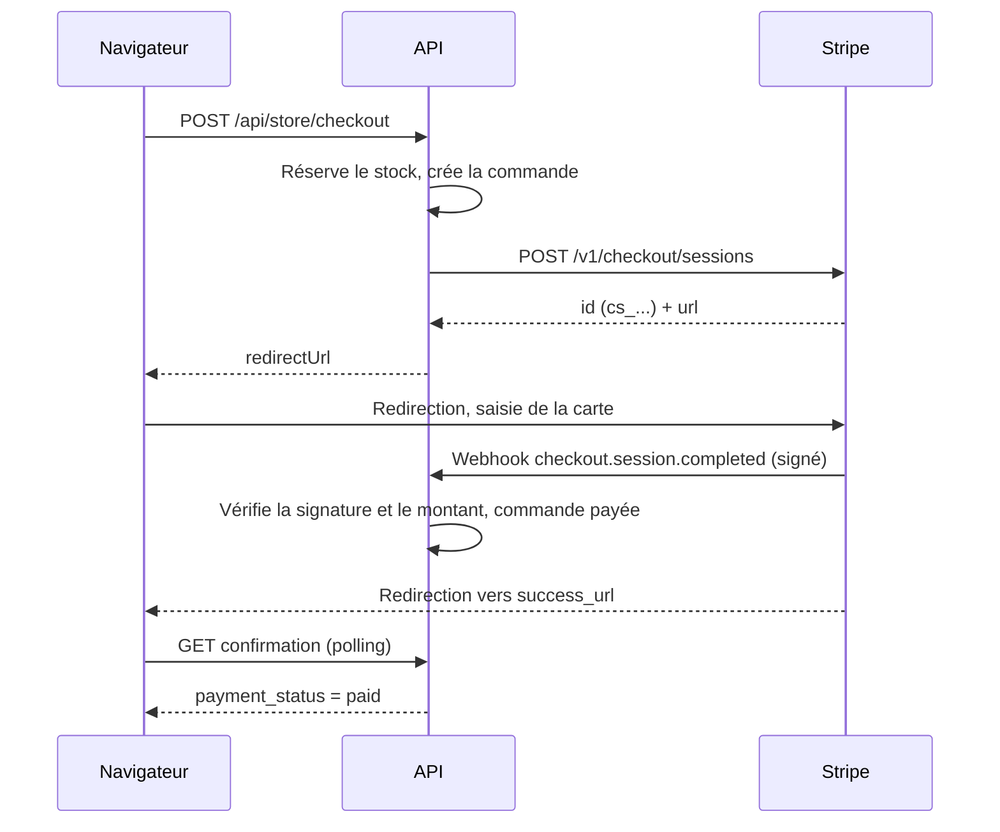

# Paiement par carte avec Stripe Checkout

Guide technique de l'intégration Stripe de ce projet : backend, storefront,
configuration, mise en production. Il est écrit pour être copié tel quel dans
un autre projet ou importé dans Notion. La section 13 donne une version
autonome, sans dépendance au reste du code, réutilisable dans n'importe quel
projet Node/TypeScript.

---

## Sommaire

1. Ça sert à quoi, et pourquoi « Checkout hébergé »
2. Vue d'ensemble du parcours
3. Les clés Stripe : lesquelles, où, test ou live
4. Configuration dans ce projet
5. Backend : les pièces une par une
6. Le webhook : le cœur du système
7. Stock, expiration et reprise du paiement
8. Remboursements
9. Storefront (front-end)
10. Montants et devises
11. Développer et tester en local
12. Mise en production : checklist
13. Réutiliser dans un autre projet (code autonome)
14. Sécurité : ce qui est garanti et comment
15. Dépannage
16. Limites connues et évolutions possibles

---

## 1. Ça sert à quoi, et pourquoi « Checkout hébergé »

Stripe encaisse les paiements par carte (Visa, Mastercard…), Apple Pay,
Google Pay et Link. Stripe propose deux façons de l'intégrer :

| | **Checkout hébergé** (choisi ici) | **Elements** (formulaire intégré) |
|---|---|---|
| Où la cliente saisit sa carte | Sur une page `checkout.stripe.com` | Dans un iframe Stripe sur votre site |
| Clé publique (`pk_…`) côté front | Inutile | Obligatoire |
| Conformité PCI DSS | SAQ A (la plus légère) | SAQ A également, mais plus de surface |
| 3-D Secure, Apple Pay, Google Pay | Gérés par Stripe, sans code | À brancher soi-même |
| Code front | Une redirection | Formulaire, états de chargement, erreurs |
| Personnalisation visuelle | Logo et couleurs (réglages Stripe) | Totale |

Checkout hébergé est le choix le plus sûr et le plus court. **Aucune donnée de
carte ne transite par nos serveurs ni par notre site.** Le backend crée une
« session de paiement », le navigateur y est redirigé, et Stripe nous notifie
le résultat par webhook.

> **Règle d'or.** Le retour de la cliente sur la page de succès **ne prouve
> rien** : n'importe qui peut taper cette URL. Seul le webhook signé par Stripe
> fait passer une commande en « payée ».

---

## 2. Vue d'ensemble du parcours

```
Navigateur               API (backend)                       Stripe
    │ 1. POST /checkout        │                                 │
    │ ───────────────────────► │ 2. réserve le stock, crée la    │
    │                          │    commande (pending_payment)   │
    │                          │ 3. POST /v1/checkout/sessions   │
    │                          │ ──────────────────────────────► │
    │                          │ ◄────────────────── id + url ── │
    │ ◄──── redirectUrl ────── │                                 │
    │ 4. redirection vers checkout.stripe.com                    │
    │ ─────────────────────────────────────────────────────────► │
    │                          │  5. webhook signé               │
    │                          │ ◄────── checkout.session.* ──── │
    │                          │ 6. vérifie signature, montant,  │
    │                          │    passe la commande en "paid", │
    │                          │    décrémente le stock          │
    │ ◄── 7. retour success_url (/order-confirmation?payment=success)
    │ 8. la page interroge l'API toutes les 2 s jusqu'à "paid"   │
```

Le même parcours en diagramme Mermaid (Notion l'affiche dans un bloc de code
de langage « Mermaid ») :



Les points 5 et 7 arrivent dans un ordre quelconque. La page de confirmation
gère donc l'état « paiement en cours de confirmation ».

---

## 3. Les clés Stripe : lesquelles, où, test ou live

| Clé | Format | Rôle | Utilisée ici ? |
|---|---|---|---|
| Clé secrète | `sk_test_…` / `sk_live_…` | Appels API depuis le backend | **Oui** |
| Clé restreinte | `rk_test_…` / `rk_live_…` | Clé secrète limitée à certains droits | Possible, à la place de la clé secrète |
| Secret de webhook | `whsec_…` | Vérifier que les notifications viennent bien de Stripe | **Oui** |
| Clé publique | `pk_test_…` / `pk_live_…` | Front-end, uniquement pour Elements | **Non** |

- **Où les trouver** : tableau de bord Stripe → Développeurs → Clés API. Le
  `whsec_` est affiché sur la page de l'endpoint webhook, ou par
  `stripe listen` en local.
- **Test et live sont deux mondes séparés.** Les clés, les paiements, les
  webhooks et les clients sont distincts dans chaque mode. Un `whsec_` de test
  ne vérifie pas un webhook live.
- **Clé restreinte (recommandée en production).** Droits nécessaires :
  Checkout Sessions en écriture, Refunds en écriture, Balance en lecture (pour
  le bouton « Tester »).

> **Ne jamais** committer une clé secrète, ni l'exposer au navigateur (pas de
> préfixe `NEXT_PUBLIC_`). En cas de fuite, faites-la tourner immédiatement
> depuis le tableau de bord (« Roll key »).

---

## 4. Configuration dans ce projet

### 4.1 Deux sources de clés, une priorité

Les clés peuvent venir :

1. **du panel d'administration** (Agrégateurs → Paiement → « Carte bancaire »).
   Elles sont chiffrées en base en AES-256-GCM avec `CREDENTIALS_ENCRYPTION_KEY`.
2. **des variables d'environnement** du backend, en repli.

**Une valeur saisie dans le panel gagne toujours.** Une clé fournie par
l'environnement apparaît comme « renseignée » dans le panel.

```dotenv
# apps/backend/.env
STRIPE_SECRET_KEY=sk_test_...
STRIPE_WEBHOOK_SECRET=whsec_...
```

`STRIPE_PUBLISHABLE_KEY` n'est pas lue : Checkout hébergé n'en a pas besoin.

### 4.2 Environnement « test » / « live »

Chaque prestataire a un environnement (`test` ou `live`) réglable dans le
panel. L'adaptateur **refuse les mélanges** :

- environnement `live` avec une clé `sk_test_` : refusé, car des paiements
  fictifs seraient « acceptés » en production ;
- environnement `test` avec une clé `sk_live_` : refusé, car on débiterait de
  vraies cartes pendant les essais.

Le refus apparaît au bouton « Tester » du panel et à chaque tentative de
paiement.

### 4.3 Activation

Un prestataire n'est proposé au storefront que s'il est **activé** et
**complètement configuré** (clé secrète **et** secret de webhook). Le panel
refuse d'activer Stripe tant qu'une des deux manque.

---

## 5. Backend : les pièces une par une

### 5.1 Carte des fichiers

| Fichier | Rôle |
|---|---|
| `apps/backend/src/integrations/payment/types.ts` | Contrat commun `PaymentAdapter`, partagé par tous les prestataires |
| `apps/backend/src/integrations/payment/providers/stripe.ts` | **L'adaptateur Stripe** : session, webhook, remboursement, test |
| `apps/backend/src/integrations/payment/providers/stripe.test.ts` | Tests (signature, statuts, garde test/live) |
| `apps/backend/src/integrations/payment/registry.ts` | Registre des adaptateurs + `resolveCredentials` (repli sur l'environnement) |
| `apps/backend/src/modules/orders/service.ts` | `checkout`, `resumePayment`, `markOrderPaid`, `refundOrder` |
| `apps/backend/src/modules/orders/routes.ts` | Route `POST /api/store/orders/:id/pay` (reprise) |
| `apps/backend/src/modules/webhooks/routes.ts` | Route générique `POST /api/webhooks/:provider` |
| `apps/backend/src/modules/integrations/service.ts` | Panel : liste, configuration, test des prestataires |
| `apps/backend/.env.example` | Variables documentées |

### 5.2 L'architecture « adaptateur »

Le cœur (panier, commandes, stock) ne connaît pas Stripe. Il ne connaît
qu'une interface :

```ts
interface PaymentAdapter {
  key: string;                       // "stripe" - sert aussi d'URL de webhook
  name: string;                      // libellé affiché au storefront
  supportsWebhooks: boolean;
  supportsRefunds: boolean;
  requiredCredentials: CredentialField[]; // génère le formulaire du panel
  sessionMinutes?: number;           // durée de vie minimale de la page de paiement

  initiate(ctx): Promise<{ status; providerTransactionId; redirectUrl; raw?; errorMessage? }>;
  verifyWebhook?(request, config): Promise<WebhookVerdict>;
  refund?(ctx): Promise<RefundResult>;
  test?(config): Promise<{ ok: boolean; message: string }>;
}
```

Ajouter un prestataire, c'est écrire un objet conforme et l'ajouter au
registre. Aucun autre fichier du cœur ne change. Wave, le paiement à la
livraison et le prestataire de test suivent le même contrat.

Un champ de clé peut déclarer une variable d'environnement de repli :

```ts
{ key: "secret_key", label: "Clé secrète Stripe", secret: true, env: "STRIPE_SECRET_KEY" }
```

`resolveCredentials(fields, credentials)` complète les clés du panel par
celles de l'environnement. Elle est appelée **après déchiffrement**, à chaque
endroit où l'on parle au prestataire : checkout, webhook, remboursement,
test.

### 5.3 `initiate` : créer la session

L'API Stripe est appelée en `fetch` simple, encodée en
`application/x-www-form-urlencoded`, sans SDK. Paramètres envoyés à
`POST /v1/checkout/sessions` :

| Paramètre | Valeur | Pourquoi |
|---|---|---|
| `mode` | `payment` | Paiement unique (pas d'abonnement) |
| `client_reference_id` | id de la commande | **Rattache le webhook à la commande** |
| `customer_email` | e-mail de la commande | Pré-remplit la page et le reçu |
| `locale` | `auto` | Langue du navigateur |
| `success_url` / `cancel_url` | page de confirmation + `payment=success` / `payment=cancelled` | Retour de la cliente |
| `expires_at` | fin de réservation − 2 min (≥ 30 min, ≤ 24 h) | Voir section 7 |
| `line_items[0]…` | **une seule ligne** au total de la commande | Remises et port sont déjà calculés côté serveur ; Stripe ne recalcule rien |
| `metadata[order_id]`, `metadata[display_id]` | références | Recherche dans le tableau de bord |
| `payment_intent_data[description]` / `[metadata][order_id]` | « Commande PF-123 » | Visible sur le paiement dans Stripe |

`payment_method_types` n'est **volontairement pas envoyé**. Les moyens de
paiement proposés se règlent donc dans le tableau de bord Stripe (Paramètres →
Moyens de paiement), sans toucher au code.

La réponse donne `id` (`cs_test_…` / `cs_live_…`), stocké comme
`providerTransactionId`, et `url`, renvoyée au storefront comme
`redirectUrl`.

En cas d'erreur (clé invalide, Stripe injoignable, délai de 15 s dépassé),
`initiate` renvoie `status: "failed"`. La commande reste réservée et passe en
`paymentStatus: "failed"`. La cliente voit alors l'écran « Paiement non
finalisé » avec un bouton de reprise.

### 5.4 `test` : le bouton « Tester » du panel

Il vérifie trois choses : la cohérence clé/environnement, la présence du
secret de webhook, puis un appel en lecture seule `GET /v1/balance`. La
réponse attendue est « Connexion à Stripe établie (mode test) ».

---

## 6. Le webhook : le cœur du système

### 6.1 Endpoint et événements

- **URL** : `<PUBLIC_API_URL>/api/webhooks/stripe`. Le panel l'affiche, prête à copier.
- **Événements à cocher** dans Stripe :

| Événement Stripe | Statut interne | Effet |
|---|---|---|
| `checkout.session.completed` avec `payment_status = paid` | `success` | Commande payée, stock décrémenté |
| `checkout.session.completed` avec `payment_status = unpaid` | `pending` | Rien (moyen de paiement différé, on attend) |
| `checkout.session.async_payment_succeeded` | `success` | Commande payée |
| `checkout.session.async_payment_failed` | `failed` | Paiement en échec, reprise possible |
| `checkout.session.expired` | `cancelled` | Tentative annulée, reprise possible si la réservation tient encore |
| tout autre événement | `pending` | Journalisé, sans effet |

### 6.2 Vérification de la signature

Stripe envoie l'en-tête :

```
Stripe-Signature: t=1700000000,v1=5257a869e7ec...,v1=...
```

L'algorithme :

1. Lire le **corps brut**, exactement les octets reçus. Re-sérialiser le JSON
   change l'ordre ou les espaces et casse la signature.
2. Extraire `t` (horodatage) et toutes les valeurs `v1`. Il y en a plusieurs
   pendant une rotation de secret.
3. Calculer `HMAC-SHA256(secret = whsec_…, message = t + "." + corpsBrut)` en
   hexadécimal.
4. Comparer **en temps constant** (`timingSafeEqual`) à chaque `v1`.
5. Refuser si `|maintenant − t| > 300 s`, contre le rejeu d'un webhook capturé.

Un événement mal signé est **journalisé** (`webhook_events.signature_valid = false`)
puis rejeté avec un 400. Il n'est jamais appliqué.

### 6.3 Les garanties de la route `/api/webhooks/:provider`

| Garantie | Mécanisme |
|---|---|
| **Authenticité** | Signature vérifiée par l'adaptateur avant toute action |
| **Idempotence** | Index unique `(provider_key, external_id)` sur `webhook_events`, avec `external_id = evt_…`. Un événement rejoué renvoie 200 `duplicate` sans rien refaire |
| **Montant** | `amount_total` notifié comparé au `total` de la commande ; un écart bloque la confirmation |
| **Tentative précise** | La mise à jour de `transactions` cible le `cs_…` de l'événement : l'expiration d'une ancienne session ne touche pas la nouvelle |
| **Pas de faux échec** | La commande ne passe en `failed` que si **aucune autre tentative** n'est encore en cours |
| **Commande annulée** | Un paiement reçu sur une commande annulée ne la ressuscite pas ; il est journalisé « à rembourser » |
| **Référence étrangère** | Un `client_reference_id` qui n'est pas un uuid (autre application sur le même compte Stripe) est ignoré proprement au lieu de faire échouer SQL en boucle |
| **Erreur transitoire** | En cas d'exception, l'événement est **retiré** du journal et la route répond 500 : Stripe réessaie, et le rejeu n'est pas pris pour un doublon. Retraiter est sans risque car `markOrderPaid` est idempotent |

Codes de réponse : `200` traité ou doublon, `400` signature invalide, `404`
prestataire inconnu ou non configuré, `409` montant divergent, `500` erreur à
réessayer. Stripe réessaie toute réponse non-2xx pendant 3 jours, avec un
délai croissant.

### 6.4 Tables concernées

| Table | Contenu |
|---|---|
| `webhook_events` | Chaque notification reçue : type, payload brut, signature valide ou non, date de traitement, erreur éventuelle |
| `transactions` | Chaque tentative de paiement (`kind = payment`, `provider_transaction_id = cs_…`) et chaque remboursement (`kind = refund`, `re_…`), avec la réponse brute de Stripe |
| `orders` | `status` (`pending_payment` → `paid`…) et `payment_status` (`pending`, `paid`, `failed`, `refunded`…) |
| `stock_reservations` | Réservations liées à la commande : `active`, `consumed`, `expired`, `released` |

---

## 7. Stock, expiration et reprise du paiement

### 7.1 Le problème

Au passage en commande, le stock est **réservé**, pas décrémenté. Une tâche de
fond libère chaque minute les réservations expirées (délai réglé dans le panel,
20 min par défaut).

Or Stripe impose qu'une session vive **au moins 30 minutes**. Sans précaution,
une cliente pourrait payer à la 25ᵉ minute un article déjà relâché, et
peut-être revendu entre-temps.

### 7.2 La solution

- L'adaptateur déclare `sessionMinutes: 35`.
- La réservation dure `max(réglage boutique, 35 min)`.
- La session Stripe expire **2 minutes avant** la réservation.

Stripe refuse donc tout paiement après l'expiration de la session, et la
réservation tient toujours au moment du dernier paiement possible.

### 7.3 Reprise du paiement

Cas couverts : clic sur « retour » depuis la page Stripe, refus de carte,
session expirée, échec à la création de la session.

Route : `POST /api/store/orders/:id/pay`, corps `{ "token": "<jeton de confirmation>" }`.
Elle est autorisée par le même jeton signé que la page de confirmation, ce qui
permet aux commandes invitées de l'utiliser.

Déroulé (`resumePayment` dans `orders/service.ts`) :

1. Vérifie le jeton en temps constant, puis que la commande est
   `pending_payment` avec un paiement `pending` ou `failed`.
2. **Prolonge** les réservations actives. S'il n'en reste aucune, répond 409
   « Le délai de réservation de cette commande est dépassé. Merci de repasser
   commande. » Les articles ont pu être vendus, on ne les re-réserve pas en
   douce.
3. Appelle `initiate` avec `previousTransactionId` (le dernier `cs_…`) :
   - session encore `open` : **elle est réutilisée** (même URL). Cela évite
     deux pages payables pour une même commande, donc un double débit ;
   - session `complete` : la cliente est renvoyée vers la page de succès
     (le webhook arrive) ;
   - sinon : une nouvelle session est créée et journalisée.
4. Repasse `payment_status` de `failed` à `pending`.

---

## 8. Remboursements

Depuis le panel (fiche commande → Rembourser), en total ou partiel, par
montant ou par ligne avec remise en stock optionnelle.

Côté Stripe (`refund` dans l'adaptateur) :

1. `GET /v1/checkout/sessions/{cs_…}` pour récupérer le `payment_intent`.
   C'est lui qui est remboursable, pas la session.
2. `POST /v1/refunds` avec `payment_intent`, `amount`,
   `reason=requested_by_customer` et la raison saisie dans
   `metadata[reason]`.
3. Statut Stripe `succeeded` → remboursé ; `pending` ou `requires_action` →
   en cours (accepté) ; `failed` ou `canceled` → refusé, et rien n'est écrit
   en base.

Le remboursement cible **la tentative encaissée** (`transactions.status = success`),
pas une session abandonnée antérieure.

---

## 9. Storefront (front-end)

### 9.1 Fichiers

| Fichier | Rôle |
|---|---|
| `apps/web/src/features/checkout/components/steps/payment-step.tsx` | Choix du moyen de paiement ; encart « Paiement sécurisé par Stripe » |
| `apps/web/src/features/checkout/api/complete-cart.tsx` | Crée la commande, puis `window.location.assign(redirectUrl)` |
| `apps/web/src/features/checkout/components/steps/review-step.tsx` | Ne navigue pas par-dessus la redirection ; route vers la reprise si l'initiation échoue |
| `apps/web/src/features/order-confirmation/views/index.tsx` | États « confirmation en cours », « non finalisé + reprise », « payée » |
| `apps/web/src/lib/store-api/queries.ts` | `resumeOrderPayment(orderId, token)` |
| `apps/web/src/lib/store-api/adapters.ts`, `types.ts` | Champ `payment_status` exposé à la vue |
| `apps/web/translations/fr.json`, `en.json` | Textes |

### 9.2 Étape paiement

Aucun champ carte sur le site. L'ancien formulaire carte (numéro, CVV…),
reliquat d'un ancien thème, a été supprimé : il n'envoyait les données nulle
part, et un site ne doit **jamais** collecter un numéro de carte lui-même.

### 9.3 Passage en commande

```ts
const result = await completeCheckout(payload);  // POST /api/store/checkout
clearCart();                                       // la commande existe, on peut vider
if (result.redirectUrl) window.location.assign(result.redirectUrl);
```

Dans l'étape de revue :

- `redirectUrl` présent : on ne fait **rien d'autre**, le bouton reste
  désactivé pendant que le navigateur part vers Stripe. Un `router.push` à ce
  moment interromprait la redirection ;
- `paymentStatus === "failed"` : navigation vers
  `/order-confirmation?…&payment=failed` ;
- sinon (paiement à la livraison) : navigation normale vers la confirmation.

### 9.4 Page de confirmation : trois états

Le paramètre `payment` de l'URL vient de `success_url` / `cancel_url` :

| Condition | Affichage |
|---|---|
| `payment=success` et `payment_status = pending` | « Confirmation du paiement en cours… ». La page interroge l'API **toutes les 2 s, pendant 60 s maximum**, puis affiche « La confirmation prend plus de temps que prévu… » |
| `payment_status = failed`, ou `payment=cancelled`/`failed` avec un paiement encore `pending` | « Paiement non finalisé » + bouton **Reprendre le paiement** (`POST /orders/:id/pay`, puis redirection). Une erreur 409 (réservation expirée) affiche le message de l'API |
| sinon | En-tête « Merci pour votre commande ! » habituel |

Le polling utilise `refetchInterval` de TanStack Query :

```ts
refetchInterval: (query) =>
  paymentReturn === "success" &&
  query.state.data?.payment_status === "pending" &&
  !confirmationSlow
    ? 2_000
    : false,
```

---

## 10. Montants et devises

Tous les montants du projet sont des **entiers en plus petite unité**, avec
les mêmes exposants que Stripe :

| Devise | Exposant | 15 000 F CFA / 23,90 € | Envoyé à Stripe |
|---|---|---|---|
| XOF | 0 (sans décimale) | `15000` | `unit_amount=15000` |
| EUR | 2 | `2390` | `unit_amount=2390` |
| USD | 2 | `2390` | `unit_amount=2390` |

Les montants passent donc **tels quels**, dans les deux sens : envoi de la
session et contrôle de `amount_total` dans le webhook.

> **Dans un autre projet**, vérifiez ce point en premier. Stripe attend la
> plus petite unité (centimes pour EUR) et traite certaines devises sans
> décimale (XOF, XAF, JPY, KRW…). Envoyer `23.90` ou `2390` pour du XOF est
> une erreur classique : ×100 sur la facture.

À savoir sur le XOF : Stripe l'accepte comme devise de présentation. Le
versement se fait dans la devise du compte Stripe, avec conversion. Il existe
aussi un montant minimum par paiement (équivalent d'environ 0,50 $).

---

## 11. Développer et tester en local

### 11.1 Mise en route

Procéder dans cet ordre :

1. Mettre `STRIPE_SECRET_KEY=sk_test_…` dans `apps/backend/.env`.
2. Installer le Stripe CLI (<https://docs.stripe.com/stripe-cli> ; sur Arch :
   paquet AUR `stripe-cli`), puis lancer `stripe login`.
3. Relayer les webhooks vers l'API locale :
   ```bash
   stripe listen --forward-to localhost:7777/api/webhooks/stripe
   ```
   La commande affiche `Your webhook signing secret is whsec_…`.
4. Copier ce `whsec_…` dans `STRIPE_WEBHOOK_SECRET`, puis redémarrer le backend.
   Ce secret est propre à `stripe listen`, différent de celui de production.
5. Dans le panel : Agrégateurs → « Carte bancaire », environnement `test`,
   **Tester**, puis **Activer**.
6. Passer une commande sur le storefront. Garder `stripe listen` ouvert
   pendant les tests : sans lui, aucun webhook n'arrive et la commande reste
   en « confirmation en cours ».

### 11.2 Cartes de test

N'importe quelle date future, n'importe quel CVC, n'importe quel code postal.

| Numéro | Résultat |
|---|---|
| `4242 4242 4242 4242` | Paiement accepté |
| `4000 0025 0000 3155` | Exige 3-D Secure (fenêtre d'authentification) |
| `4000 0000 0000 9995` | Refusé : fonds insuffisants |
| `4000 0000 0000 0002` | Refusé : carte refusée |

### 11.3 Scénarios à dérouler avant la mise en ligne

| Scénario | Attendu |
|---|---|
| Paiement `4242…` | Écran « confirmation en cours », puis « Merci » ; commande `paid` dans le panel ; stock décrémenté |
| Clic sur « ← » sur la page Stripe | « Paiement non finalisé » ; « Reprendre » renvoie vers **la même** page Stripe |
| Carte refusée puis bonne carte | Paiement accepté au second essai sur la même session |
| Remboursement partiel depuis le panel | Remboursement visible dans Stripe ; commande `partially_refunded` |
| Environnement `live` + clé `sk_test_` | « Tester » refuse avec un message explicite |
| Rejeu d'un événement (tableau de bord Stripe → Événements → Renvoyer) | 200 `duplicate`, rien n'est appliqué deux fois |

### 11.4 Tests automatisés

```bash
cd apps/backend && pnpm test
```

Sans réseau, ils couvrent : vérification de signature (bon secret, mauvais
secret, corps altéré, signature périmée, en-tête absent), correspondance
événement → statut, refus d'une clé de test en `live`.

---

## 12. Mise en production : checklist

**Compte Stripe**

- [ ] Compte activé (informations légales et bancaires complètes) pour
      obtenir les clés live.
- [ ] Paramètres → Moyens de paiement : activer carte, Apple Pay, Google Pay,
      Link selon le besoin.
- [ ] Paramètres → Image de marque : logo, couleurs, nom public. Ils
      apparaissent sur la page de paiement et sur les reçus.
- [ ] Paramètres → E-mails clients : reçus de paiement et de remboursement
      (optionnel).

**Clés et webhook**

- [ ] Créer une clé restreinte `rk_live_…` (Checkout Sessions et Refunds en
      écriture, Balance en lecture), ou utiliser `sk_live_…`.
- [ ] Développeurs → Webhooks → Ajouter un endpoint :
      `https://<api-de-production>/api/webhooks/stripe`, avec les 4 événements
      `checkout.session.completed`, `checkout.session.expired`,
      `checkout.session.async_payment_succeeded`,
      `checkout.session.async_payment_failed`.
- [ ] Copier le `whsec_…` de **cet** endpoint.
- [ ] Chez l'hébergeur du backend : `STRIPE_SECRET_KEY` et
      `STRIPE_WEBHOOK_SECRET` (ou les saisir dans le panel).

**Variables du backend**

- [ ] `PUBLIC_API_URL` : URL publique **HTTPS** de l'API. Elle sert à afficher
      l'URL de webhook dans le panel.
- [ ] `STOREFRONT_URL` : URL publique du site. Elle sert aux URLs de retour
      après paiement.
- [ ] `CREDENTIALS_ENCRYPTION_KEY` : propre à la production et sauvegardée.
      La perdre rend illisibles les clés saisies dans le panel.

**Panel**

- [ ] Agrégateurs → « Carte bancaire » → environnement **live** → **Tester**
      (« Connexion à Stripe établie (mode live) ») → **Activer**.

**Vérification finale**

- [ ] Un vrai paiement de faible montant avec une vraie carte, puis le
      rembourser depuis le panel.
- [ ] Développeurs → Webhooks → l'endpoint : livraisons en 200.

**Exploitation courante**

- Surveiller la table `webhook_events` : lignes avec `error_message`, ou
  `signature_valid = false` en série (mauvais `whsec_`).
- Stripe envoie un e-mail si l'endpoint échoue de façon répétée, et peut le
  désactiver au bout de plusieurs jours d'échecs.
- Rotation du secret de webhook : Stripe permet une période où l'ancien et le
  nouveau secret sont valides (plusieurs `v1`, déjà gérés). Mettre à jour
  `STRIPE_WEBHOOK_SECRET` pendant cette période.

---

## 13. Réutiliser dans un autre projet (code autonome)

Version minimale et complète, sans SDK ni dépendance, pour Node 18+ et
n'importe quel framework. Adaptez les trois fonctions marquées `// À BRANCHER`
à votre base de données.

### 13.1 Prérequis

- Montants stockés en entiers, en plus petite unité (section 10).
- Une table d'idempotence des webhooks :

```sql
create table webhook_events (
  id           uuid primary key default gen_random_uuid(),
  provider     varchar(64)  not null,
  external_id  varchar(255) not null,       -- evt_...
  type         varchar(120),
  payload      jsonb        not null,
  processed_at timestamptz,
  error        text,
  created_at   timestamptz  not null default now(),
  unique (provider, external_id)
);
```

### 13.2 `stripe.ts` : appels API et signature

```ts
import { createHmac, timingSafeEqual } from "node:crypto";

const API = "https://api.stripe.com/v1";
const SECRET_KEY = process.env.STRIPE_SECRET_KEY!;
const WEBHOOK_SECRET = process.env.STRIPE_WEBHOOK_SECRET!;

type Json = Record<string, any>;

async function stripe(path: string, params?: Record<string, string | number>): Promise<Json> {
  const res = await fetch(`${API}${path}`, {
    method: params ? "POST" : "GET",
    headers: {
      Authorization: `Bearer ${SECRET_KEY}`,
      "Content-Type": "application/x-www-form-urlencoded",
    },
    body: params
      ? new URLSearchParams(
          Object.entries(params).map(([k, v]): [string, string] => [k, String(v)]),
        )
      : undefined,
    signal: AbortSignal.timeout(15_000),
  });
  const body = (await res.json().catch(() => ({}))) as Json;
  if (!res.ok) throw new Error(body.error?.message ?? `Stripe HTTP ${res.status}`);
  return body;
}

/** Crée la page de paiement. `amount` en plus petite unité. */
export async function createCheckoutSession(order: {
  id: string; amount: number; currency: string; email: string; label: string;
}, urls: { success: string; cancel: string }, expiresAt?: Date) {
  const now = Math.floor(Date.now() / 1000);
  const expires = Math.min(
    Math.max(Math.floor((expiresAt?.getTime() ?? 0) / 1000), now + 31 * 60), // min 30 min
    now + 24 * 3600 - 60,                                                     // max 24 h
  );
  const session = await stripe("/checkout/sessions", {
    mode: "payment",
    client_reference_id: order.id,
    customer_email: order.email,
    locale: "auto",
    success_url: urls.success,
    cancel_url: urls.cancel,
    expires_at: expires,
    "line_items[0][quantity]": 1,
    "line_items[0][price_data][currency]": order.currency.toLowerCase(),
    "line_items[0][price_data][unit_amount]": order.amount,
    "line_items[0][price_data][product_data][name]": order.label,
    "metadata[order_id]": order.id,
    "payment_intent_data[metadata][order_id]": order.id,
  });
  return { sessionId: session.id as string, url: session.url as string };
}

/** Réutilise une session encore ouverte (reprise sans double débit). */
export async function getOpenSessionUrl(sessionId: string): Promise<string | null> {
  const s = await stripe(`/checkout/sessions/${encodeURIComponent(sessionId)}`);
  return s.status === "open" ? (s.url as string) : null;
}

/** Remboursement total (sans `amount`) ou partiel. */
export async function refundSession(sessionId: string, amount?: number) {
  const s = await stripe(`/checkout/sessions/${encodeURIComponent(sessionId)}`);
  return stripe("/refunds", {
    payment_intent: s.payment_intent,
    ...(amount ? { amount } : {}),
    reason: "requested_by_customer",
  });
}

/** Vérifie `Stripe-Signature` sur le corps BRUT. */
export function verifyStripeSignature(rawBody: string, header: string | null, toleranceSec = 300): boolean {
  if (!header) return false;
  const parts = header.split(",").map((p) => p.trim().split("="));
  const t = parts.find(([k]) => k === "t")?.[1];
  const sigs = parts.filter(([k, v]) => k === "v1" && v).map(([, v]) => v!);
  if (!t || sigs.length === 0) return false;
  if (Math.abs(Date.now() / 1000 - Number(t)) > toleranceSec) return false;

  const expected = Buffer.from(
    createHmac("sha256", WEBHOOK_SECRET).update(`${t}.${rawBody}`).digest("hex"),
  );
  return sigs.some((s) => {
    const got = Buffer.from(s);
    return got.length === expected.length && timingSafeEqual(got, expected);
  });
}
```

### 13.3 Route webhook (exemple Hono ; même logique en Express ou Next)

```ts
import { Hono } from "hono";
import { verifyStripeSignature } from "./stripe";

export const webhooks = new Hono();

webhooks.post("/stripe", async (c) => {
  const raw = await c.req.text();                       // BRUT, jamais c.req.json()
  if (!verifyStripeSignature(raw, c.req.header("stripe-signature") ?? null)) {
    return c.json({ received: false }, 400);
  }
  const event = JSON.parse(raw);

  // Idempotence : insert ... on conflict do nothing returning id
  const inserted = await saveEventOnce("stripe", event.id, event.type, event);  // À BRANCHER
  if (!inserted) return c.json({ received: true, duplicate: true });

  try {
    const s = event.data.object;
    const orderId = s.client_reference_id;
    if (s.object === "checkout.session" && orderId) {
      const paid =
        (event.type === "checkout.session.completed" && s.payment_status === "paid") ||
        event.type === "checkout.session.async_payment_succeeded";

      if (paid) {
        const order = await getOrder(orderId);                                  // À BRANCHER
        if (order && order.total === s.amount_total && order.status !== "cancelled") {
          await markOrderPaidIdempotent(orderId, s.id);                         // À BRANCHER
        }
      } else if (
        event.type === "checkout.session.expired" ||
        event.type === "checkout.session.async_payment_failed"
      ) {
        await markPaymentFailed(orderId, s.id);                                 // À BRANCHER
      }
    }
    return c.json({ received: true });
  } catch (err) {
    await deleteEvent("stripe", event.id);   // laisse Stripe réessayer        // À BRANCHER
    console.error(err);
    return c.json({ received: false }, 500);
  }
});
```

> **Piège Express / Next.js.** Un parseur JSON global consomme le corps avant
> la route. Utilisez `express.raw({ type: "application/json" })` sur cette
> route, ou `await request.text()` dans un route handler Next.js. Ne
> re-stringifiez jamais un objet déjà parsé.

`markOrderPaidIdempotent` doit verrouiller la commande
(`select … for update`), sortir sans rien faire si elle est déjà payée, puis
décrémenter le stock et passer le statut dans **la même transaction**.

### 13.4 Front-end minimal

```ts
// Passage en commande
const { redirectUrl } = await api.post("/checkout", payload);
if (redirectUrl) window.location.assign(redirectUrl);   // ne rien faire d'autre ensuite

// Page de retour : attendre le webhook
const { data: order } = useQuery({
  queryKey: ["order", id],
  queryFn: () => api.get(`/orders/${id}?token=${token}`),
  refetchInterval: (q) => (q.state.data?.paymentStatus === "pending" ? 2000 : false),
});
```

### 13.5 Avec le SDK officiel plutôt que `fetch`

Si vous préférez le SDK (`npm i stripe`), les équivalents sont :

```ts
import Stripe from "stripe";
const stripe = new Stripe(process.env.STRIPE_SECRET_KEY!);

const session = await stripe.checkout.sessions.create({ mode: "payment", /* … mêmes champs … */ });
const event = stripe.webhooks.constructEvent(rawBody, signatureHeader, process.env.STRIPE_WEBHOOK_SECRET!);
await stripe.refunds.create({ payment_intent, amount });
```

Le SDK apporte le typage et les réessais automatiques ; la version `fetch` évite
une dépendance. La logique métier (idempotence, montant, statuts, stock) reste
identique.

---

## 14. Sécurité : ce qui est garanti et comment

| Risque | Parade |
|---|---|
| Vol de numéros de carte | Aucune saisie de carte sur le site (Checkout hébergé, PCI SAQ A) |
| Commande marquée payée par un simple POST | Signature HMAC vérifiée en temps constant, sur le corps brut |
| Rejeu d'un webhook capturé | Tolérance de 5 min sur l'horodatage + idempotence par `evt_…` |
| Double décrémentation du stock | Idempotence + `markOrderPaid` qui ignore une commande déjà payée, sous verrou |
| Paiement d'un montant falsifié | `amount_total` comparé au total calculé côté serveur |
| Prix modifié côté navigateur | Le total est recalculé côté serveur au checkout ; Stripe reçoit ce total, jamais une valeur du client |
| Double débit lors d'une reprise | Réutilisation de la session ouverte |
| Paiement sur stock relâché | Session expirée avant la réservation (section 7) |
| Clé de test en production, ou l'inverse | Garde clé/environnement à l'initiation, au remboursement et au test |
| Fuite de clés en base | Chiffrement AES-256-GCM ; l'API du panel ne renvoie jamais une valeur, seulement la liste des clés renseignées |
| Accès à la commande d'un autre | Pages de confirmation et de reprise protégées par un jeton HMAC propre à la commande, comparé en temps constant |

---

## 15. Dépannage

| Symptôme | Cause probable | Solution |
|---|---|---|
| « Carte bancaire » absente du storefront | Non activé, ou clé/secret webhook manquant | Panel → Agrégateurs : renseigner les deux clés, Tester, Activer |
| Bloqué sur « Confirmation du paiement en cours… » | Le webhook n'arrive pas | En local : `stripe listen` lancé ? En production : URL de l'endpoint, HTTPS, 4 événements cochés |
| Webhooks en 400 « Signature invalide » | Mauvais `whsec_` (celui de `stripe listen` en prod, ou de test en live), ou corps modifié par un proxy ou un middleware | Recopier le secret de **cet** endpoint ; vérifier qu'aucun middleware ne lit le corps avant |
| Webhooks en 400 « Signature expirée » | Horloge du serveur décalée | Synchroniser l'heure (NTP) |
| Webhooks en 404 | Stripe jamais enregistré dans le panel, ou mauvaise clé de prestataire dans l'URL | Configurer et activer Stripe ; l'URL doit finir par `/api/webhooks/stripe` |
| Webhooks en 409 | Montant notifié ≠ total de la commande | Vérifier les exposants de devise (section 10) |
| « Environnement live mais clé Stripe de test » | Mélange test/live | Mettre la bonne clé ou changer l'environnement dans le panel |
| Reprise : « délai de réservation dépassé » | Réservation expirée, stock relâché | Comportement voulu : repasser commande |
| `stripe trigger checkout.session.completed` sans effet sur une commande | L'événement simulé n'a pas de `client_reference_id` | Normal, il est journalisé sans effet ; tester avec un vrai parcours storefront |
| `webhook_events.error_message` « Paiement reçu pour une commande annulée » | Commande annulée alors que la page Stripe était encore ouverte | Rembourser depuis le tableau de bord Stripe |

---

## 16. Limites connues et évolutions possibles

- **Paiement reçu sur une commande annulée** : journalisé, mais pas
  remboursé automatiquement. Évolution possible : expirer la session Stripe
  (`POST /v1/checkout/sessions/{id}/expire`) au moment de l'annulation, ou
  rembourser automatiquement.
- **Moyens de paiement différés** (prélèvement SEPA…) : leur confirmation peut
  prendre plusieurs jours, plus longtemps que la réservation de stock. Pour
  XOF ils n'existent pas ; en EUR, ne les activez pas dans le tableau de bord
  sans revoir la réservation.
- **Version d'API non épinglée** : les appels utilisent la version par défaut
  du compte Stripe. Les champs lus (`id`, `url`, `status`, `payment_status`,
  `client_reference_id`, `amount_total`, `currency`, `payment_intent`) sont
  stables entre versions. Pour figer, ajouter l'en-tête `Stripe-Version`.
- **Pas de réconciliation sans webhook** : si les webhooks sont coupés, rien
  ne rattrape les paiements. Évolution possible : une tâche qui interroge les
  sessions des commandes `pending_payment` encore ouvertes.
- **Libération du stock** : la tâche tourne dans le processus de l'API, ce qui
  suffit pour une instance unique. En cas de plusieurs instances, la déplacer
  dans un worker dédié.
